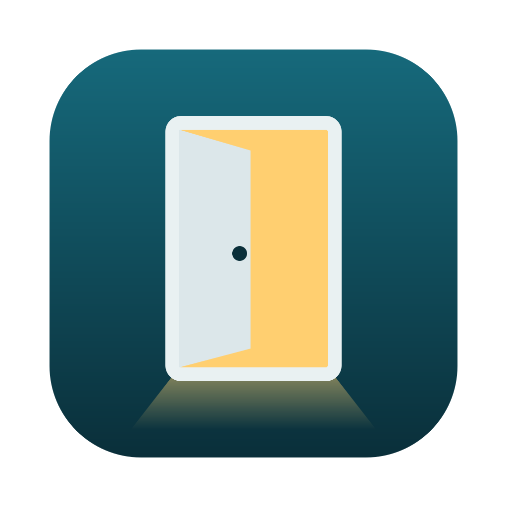
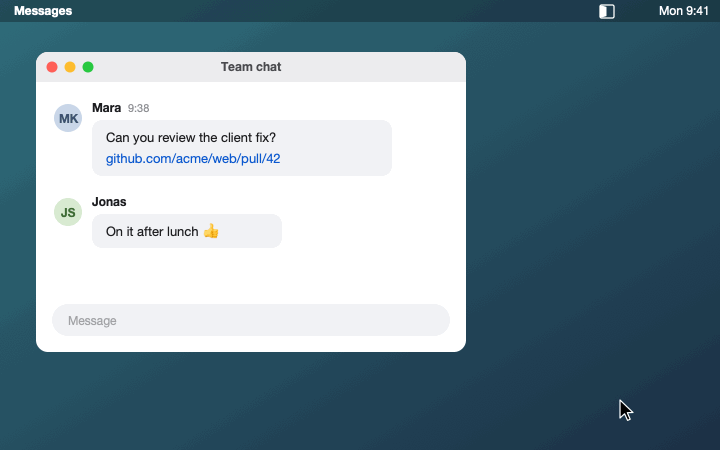

<div align="center">



# Doorman

A link picker for macOS. Click a link anywhere, then choose the Zen space, Chrome profile or browser it opens in.

[](https://github.com/schowave/doorman/actions/workflows/ci.yml)
[](https://github.com/schowave/doorman/releases)
[](LICENSE)



</div>

## Why I built it

I use [Zen](https://zen-browser.app) with one space per client, each with its own container. Links from Slack, Mail or Teams always opened in whatever space happened to be active, so I kept ending up in the wrong account and moving tabs around by hand.

[Browserosaurus](https://github.com/will-stone/browserosaurus) and [Finicky](https://github.com/johnste/finicky) solve this for browsers, but not for spaces inside a browser. Doorman shows each Zen space as its own entry, next to Chrome profiles and your other browsers. You pick one with a number key or a click.

What it does:

- reads your Zen spaces (names, icons, colors) and opens links with Zen's `--space` flag (Zen 1.24 or later)
- lists every profile of Chrome, Brave, Edge, Vivaldi and Chromium separately
- only shows real browsers, so terminals, web-app wrappers and test builds stay out of the list
- collects links that arrive at the same moment into one picker, so one choice opens them all
- runs as a small menu bar app (Swift/SwiftUI). The only network request is the update check, which you can turn off.

## Requirements

- macOS 14 (Sonoma) or later
- No Xcode on macOS 15 or later (Apple Silicon and Intel): Homebrew installs a prebuilt bottle. On macOS 14 it builds from source and needs Xcode 16.
- For spaces: [Zen](https://zen-browser.app) 1.24 or later. Older versions show up as a single entry.

## Installation

```sh
brew install schowave/tap/doorman
doorman
```

`doorman` starts the app and always points at the installed version.

On first launch Doorman asks whether it should become your default browser (macOS asks you to confirm), adds a login item and puts a link at `~/Applications/Doorman.app`. That link keeps working after `brew upgrade`. After an upgrade, quit Doorman from the menu bar and run `doorman` again.

## Usage

Click a link in any app and the picker opens at the mouse pointer:

| Key | Action |
|---|---|
| `1` … `9`, `0`, or a custom key | Open the link in that target |
| `↑` `↓`, then `Enter` | Move the selection, then open |
| `⌘C` | Copy the URL(s) |
| `Esc`, or a click outside the panel | Cancel |

The menu bar icon has **Settings…** (⌘,) and **Check for Updates…**. If Doorman isn't your default browser, the menu tells you and offers to fix it. The app is in English or German, depending on your system language.

## Configuration

Open **Settings…** from the menu bar, or run `doorman` while it's already running. Under *Targets* you can drag entries into a different order, hide them, rename them, give them a key and star the one `Enter` should open. **+** adds any app, **−** removes it again. *General* has the default browser, login item and update check, *Advanced* the Zen profile and the config file.

Everything ends up in `~/.config/doorman/config.json`, so you can also edit that by hand or keep it in your dotfiles:

```json
{
  "defaultTarget": "zen:{b4ac0402-9e47-4873-89b6-5dfeffe77a7e}",
  "order": ["zen:{b4ac0402-9e47-4873-89b6-5dfeffe77a7e}", "app:com.apple.Safari"],
  "hidden": ["app:com.google.Chrome.beta"],
  "extraApps": ["com.googlecode.iterm2"],
  "targets": {
    "zen:{b4ac0402-9e47-4873-89b6-5dfeffe77a7e}": { "label": "Personal", "hotkey": "p" }
  },
  "zen": { "profilePath": null }
}
```

| Key | Meaning |
|---|---|
| `defaultTarget` | Target that `Enter` opens. Without it, the first entry. |
| `order` | Targets listed first, in this order. All other targets follow in the default order: Zen workspaces, then Chromium profiles, then other browsers A–Z. |
| `hidden` | Targets left out of the picker. |
| `extraApps` | Bundle IDs of apps that aren't known browsers but should appear anyway. |
| `targets.<id>.label` | Display name for the target. |
| `targets.<id>.hotkey` | A single key that opens this target. Targets without one get number keys. |
| `zen.profilePath` | Zen profile to use when it isn't the default profile from `profiles.ini`. |

Target IDs come in three forms:

| ID | Target |
|---|---|
| `zen:{uuid}` | A Zen workspace |
| `chromium:<bundleId>:<profileDir>` | A Chromium profile, e.g. `chromium:com.google.Chrome:Profile 2` |
| `app:<bundleId>` | Any other browser |

Doorman reads the file each time the picker opens, so changes apply right away. If the file is broken, the picker shows a warning and falls back to the defaults.

## How it works

Zen keeps its spaces in `zen-sessions.jsonlz4` in the profile folder (Mozilla's LZ4 format). Doorman reads that file and opens a link with `zen --space "{uuid}" <url>`. If Zen is already running, the command goes to that instance; if not, Doorman starts Zen through LaunchServices and it opens in the chosen space. The space icons come from Zen's `omni.ja` and are cached per Zen version.

Chromium profiles come from each browser's `Local State` file, and links open with `open -na <App> --args --profile-directory=<dir> <url>`.

The details are in [SPEC.md](SPEC.md).

## Troubleshooting

<details>
<summary><b>A Zen workspace I just created is missing</b></summary>

Zen doesn't write its session file after every change. The space shows up once Zen has saved, which usually doesn't take long.
</details>

<details>
<summary><b>Zen shows up as one entry without workspaces</b></summary>

You need Zen 1.24 or later, since that's where `--space` came in. If you don't use Zen's default profile, pick yours under *Settings → Advanced*.
</details>

<details>
<summary><b>A browser is missing from the list</b></summary>

Doorman only lists known browsers from `/Applications`, `~/Applications` and `/System`. Add anything else with **+** under *Settings → Targets*.
</details>

<details>
<summary><b>"Start at login" is on, but Doorman doesn't start at login</b></summary>

The checkmark only means the LaunchAgent exists. macOS can still block it, so check **System Settings → General → Login Items & Extensions** and allow Doorman under *Allow in the Background*.
</details>

<details>
<summary><b>Links still open in my old browser</b></summary>

Open the menu bar menu. If it says Doorman isn't your default browser, choose **Make Default Browser** and confirm the macOS dialog.
</details>

## Updates

Doorman looks for a new release on GitHub once a day (you can switch that off in the settings). If there is one, **Update in Terminal** runs `brew upgrade doorman` and restarts the app. Or do it yourself:

```sh
brew upgrade doorman && doorman
```

## Uninstall

```sh
brew uninstall doorman
rm -f ~/Applications/Doorman.app ~/Library/LaunchAgents/io.github.schowave.doorman.plist
rm -rf ~/.config/doorman ~/Library/Caches/io.github.schowave.doorman
```

Then pick another default browser in **System Settings → Desktop & Dock → Default web browser**.

## Development

Tooling and tasks run through [mise](https://mise.jdx.dev); Swift comes from Xcode.

```sh
mise install        # actionlint, shellcheck, swiftformat (pinned in mise.toml)
mise tasks          # list all tasks
mise run test       # unit tests
mise run run        # build build/Doorman.app and start it
mise run format     # swiftformat
mise run ci         # lint, unit tests, release-script tests, app bundle, formula check
mise run demo-gif   # re-render docs/demo.gif from docs/demo/frames.py
mise run social-preview  # re-render docs/social/preview.png (GitHub social preview)
```

The logic lives in `Sources/DoormanCore` and is tested without the UI; `Sources/Doorman` is the app itself. [GLOSSARY.md](GLOSSARY.md) explains the terms used in the code. The tasks in `.mise/tasks/` are plain shell scripts, and the Homebrew formula calls `.mise/tasks/install` directly, so installing doesn't need mise.

### Releases and dependencies

Pushing a tag like `v0.2.0` runs [`release.yml`](.github/workflows/release.yml): tests, build, GitHub release, bottles for Apple Silicon and Intel (built on macOS 15) attached to the release, and an updated `Formula/doorman.rb` with a `bottle do` block in [schowave/homebrew-tap](https://github.com/schowave/homebrew-tap). CI also builds the formula from a source tarball as a bottle (`mise run bottle`), pours that bottle again and runs `brew test` and `brew audit --strict`.

Renovate opens a weekly pull request for GitHub Actions and one for the mise tools, waits seven days after a release before picking it up, and asks before major updates. It merges once CI is green. If a merge changes the app itself, [`auto-release.yml`](.github/workflows/auto-release.yml) tags and releases the next patch version.

## Acknowledgements

Thanks to [Browserosaurus](https://github.com/will-stone/browserosaurus) and [Finicky](https://github.com/johnste/finicky) for the idea, and to the [Zen](https://github.com/zen-browser/desktop) team for the `--space` flag that makes this possible.

## License

[MIT](LICENSE) © David Schowalter
