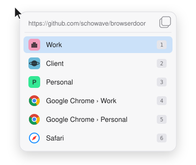

<div align="center">

# Doorman

**Every link, through the right door.**

Doorman is a macOS link picker. When you click a link anywhere, it asks where the link should go: a specific **Zen workspace**, a **Chrome profile** or another browser.

[](https://github.com/schowave/doorman/actions/workflows/ci.yml)
[](https://github.com/schowave/doorman/releases)


[](LICENSE)



</div>

## Why

[Browserosaurus](https://github.com/will-stone/browserosaurus) and [Finicky](https://github.com/johnste/finicky) pick a browser. With [Zen](https://zen-browser.app), you also want to pick **where inside the browser** a link goes, such as the work, client or personal workspace. Doorman lists every Zen workspace as its own target, next to Chromium profiles and your other browsers.

## Features

- **Zen workspaces as targets.** Doorman reads your workspaces with their names, icons and colors, and opens links with Zen's official `--space` flag (Zen 1.24 or later).
- **Chromium profiles.** Chrome, Brave, Edge, Vivaldi and Chromium each list every profile as its own target.
- **All your real browsers.** Doorman detects them from a built-in list, so terminals, web-app wrappers and test builds stay out of the list.
- **Keyboard first.** Every target has a number key. `Enter` opens the default target.
- **Several links at once.** When several links arrive at the same time, they share one panel, and a single choice opens them all.
- **Small and native.** A menu bar app in Swift and SwiftUI, with no Electron and no background network access.
- **Safe with odd input.** Only `http`, `https` and `file` URLs are passed on to a browser.

## Requirements

- macOS 14 (Sonoma) or later
- Xcode or the Command Line Tools with Swift 6, because Homebrew builds Doorman from source
- For workspace targets: [Zen](https://zen-browser.app) 1.24 or later. Older Zen versions show up as a single target.

## Installation

```sh
brew install schowave/tap/doorman
open "$(brew --prefix)/opt/doorman/Doorman.app"
```

On first launch, Doorman:

1. offers to become your **default browser**. macOS then asks you to confirm.
2. adds a **login item**, a LaunchAgent in `~/Library/LaunchAgents`.
3. links itself to `~/Applications/Doorman.app`. That path keeps pointing at the current version after `brew upgrade`.

**After `brew upgrade doorman`**, quit Doorman from the menu bar and start it again with `open ~/Applications/Doorman.app`.

## Usage

Click a link in any app. The picker opens at the mouse pointer:

| Key | Action |
|---|---|
| `1` … `9`, `0`, or a custom key | Open the link in that target |
| `↑` `↓`, then `Enter` | Move the selection, then open |
| `⌘C` | Copy the URL(s) |
| `Esc`, or a click outside the panel | Cancel |

The menu bar icon shows whether Doorman is the default browser. It lets you switch the login item on or off and opens the configuration file. The menu labels are in German.

## Configuration

The configuration is optional. Choose **Konfiguration öffnen…** in the menu bar menu. If the file doesn't exist yet, Doorman creates `~/.config/doorman/config.json` and fills it with every target it currently detects. Edit that file to change the targets.

```json
{
  "defaultTarget": "zen:{b4ac0402-9e47-4873-89b6-5dfeffe77a7e}",
  "order": ["zen:{b4ac0402-9e47-4873-89b6-5dfeffe77a7e}", "app:com.apple.Safari"],
  "hidden": ["app:com.google.Chrome.beta"],
  "extraApps": ["com.googlecode.iterm2"],
  "targets": {
    "zen:{b4ac0402-9e47-4873-89b6-5dfeffe77a7e}": { "label": "Personal", "hotkey": "p" }
  },
  "zen": { "profilePath": null }
}
```

| Key | Meaning |
|---|---|
| `defaultTarget` | Target that `Enter` opens. Without it, the first entry. |
| `order` | Targets listed first, in this order. All other targets follow in the default order: Zen workspaces, then Chromium profiles, then other browsers A–Z. |
| `hidden` | Targets left out of the picker. |
| `extraApps` | Bundle IDs of apps that aren't known browsers but should appear anyway. |
| `targets.<id>.label` | Display name for the target. |
| `targets.<id>.hotkey` | A single key that opens this target. Targets without one get number keys. |
| `zen.profilePath` | Zen profile to use when it isn't the default profile from `profiles.ini`. |

Target IDs come in three forms:

| ID | Target |
|---|---|
| `zen:{uuid}` | A Zen workspace |
| `chromium:<bundleId>:<profileDir>` | A Chromium profile, e.g. `chromium:com.google.Chrome:Profile 2` |
| `app:<bundleId>` | Any other browser |

Doorman reads the file every time the picker opens, so changes apply immediately. If the file is invalid, the picker shows a warning and uses the defaults.

## How it works

- **Zen workspaces.** Doorman reads them from the Zen profile, from `zen-sessions.jsonlz4` (Mozilla's LZ4 format). For a workspace, it runs `zen --space "{uuid}" <url>`. If Zen is already running, the command reaches that instance. If Zen is closed, Doorman starts it through LaunchServices, and Zen opens in the chosen workspace.
- **Chromium profiles.** Doorman reads them from each browser's `Local State` file and opens links with `open -na <App> --args --profile-directory=<dir> <url>`.
- **Workspace icons.** Doorman extracts Zen's SVG icons once per Zen version, in the background, into `~/Library/Caches/io.github.schowave.doorman`.

More details are in [SPEC.md](SPEC.md).

## Troubleshooting

<details>
<summary><b>A Zen workspace I just created is missing</b></summary>

Zen saves its session file periodically, not after every change. The workspace appears once Zen has saved, usually within a short time.
</details>

<details>
<summary><b>Zen shows up as one entry without workspaces</b></summary>

Doorman needs Zen 1.24 or later, because that release added `--space`. It also needs to find the right profile. If you use another profile, set `zen.profilePath`.
</details>

<details>
<summary><b>A browser is missing from the list</b></summary>

Only known browsers in `/Applications`, `~/Applications` or `/System` appear. Add other apps by bundle ID under `extraApps`. To find an app's bundle ID, run `osascript -e 'id of app "AppName"'`.
</details>

<details>
<summary><b>Links still open in my old browser</b></summary>

Open the menu bar menu. If it shows *Standardbrowser: nein*, choose *Als Standardbrowser setzen* and confirm the macOS dialog.
</details>

## Uninstall

```sh
brew uninstall doorman
rm -f ~/Applications/Doorman.app ~/Library/LaunchAgents/io.github.schowave.doorman.plist
rm -rf ~/.config/doorman ~/Library/Caches/io.github.schowave.doorman
```

Then pick a new default browser in **System Settings → Desktop & Dock → Default web browser**.

## Development

[mise](https://mise.jdx.dev) provides the tooling and the tasks. Swift comes from Xcode or the Command Line Tools.

```sh
mise install        # actionlint, shellcheck, swiftformat (pinned in mise.toml)
mise tasks          # list all tasks
mise run test       # unit tests
mise run run        # build build/Doorman.app and start it
mise run format     # swiftformat
mise run ci         # everything CI runs: lint, test, app bundle, formula check
```

- `Sources/DoormanCore` contains the logic: parsers, discovery, config and launch commands. Its unit tests run without the UI.
- `Sources/Doorman` contains the app: the AppKit and SwiftUI code, the panel and the menu bar.
- The tasks in `.mise/tasks/` are plain shell scripts. The Homebrew formula runs `.mise/tasks/install` directly, so you don't need mise to install Doorman.

### Releases and dependencies

- **Manual release:** push a tag such as `v0.2.0`. [`release.yml`](.github/workflows/release.yml) then tests and builds Doorman, creates the GitHub release and updates `Formula/doorman.rb` in [schowave/homebrew-tap](https://github.com/schowave/homebrew-tap).
- **Renovate** bundles all updates, both GitHub Actions and mise tools, into one pull request every Monday and merges it once CI passes. Each merge creates a **patch release** through [`auto-release.yml`](.github/workflows/auto-release.yml).

## Acknowledgements

Doorman is inspired by [Browserosaurus](https://github.com/will-stone/browserosaurus) and [Finicky](https://github.com/johnste/finicky). It relies on [Zen](https://github.com/zen-browser/desktop)'s `--space` command-line flag.

## License

[MIT](LICENSE) © David Schowalter
